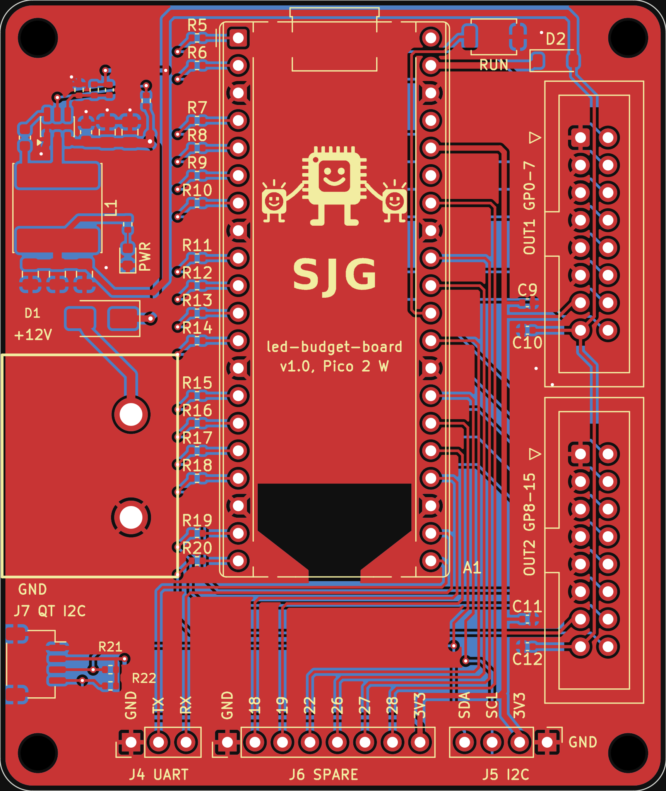

# led-budget-board

A "budget" LED processor board: a carrier for a Raspberry Pi Pico 2 W that drives 16 strands
through two of the standard 16-pin output shrouds. Little sibling of
[led-processor-board](https://github.com/eelstretching/led-processor-board).

## What it is

| | led-processor-board | led-budget-board |
|---|---|---|
| Brain | RP2350B, flash, PSRAM and RM2 radio on the board | A Pico 2 W in two 1x20 sockets |
| Outputs | 4 shrouds, 32 strands, GPIO0-31 | 2 shrouds, 16 strands: OUT1 = GP0-7, OUT2 = GP8-15 |
| RTC | DS3231 and coin cell | None: time comes from the show leader's PicoComm beacons |
| USB, BOOTSEL, LED, SWD | On the board | The Pico's own |
| Debug UART | UART1 on GPIO36/37 | UART0 on GP16 (TX) / GP17 (RX), header J4 |
| I2C | (v1.1) I2C0 on GPIO32/33 | I2C0 on GP20 (SDA) / GP21 (SCL), 10k pull-ups: pin header J5 and STEMMA QT / Qwiic socket J7 |
| Spare I/O | GPIO35-42 | GP18, GP19, GP22, GP26-28 on header J6 |
| 3.3 V | NCP1117 on the board | The Pico's 3V3 pin |

The same on both boards:

- Shroud pinout: data 1-8 on even pins 2-16, GND on odd pins 1-11, pin 13 = 3.3 V, pin 15 = 5 V.
  Pin 1 is the triangle on the shroud. 33R in series with each data line, 100 nF on each rail.
- Power: 12 V barrier terminal (the output boards' DBT50G-9.5-2P, takes 14 AWG), SS34 against a reversed lead, TPS54202H 5 V buck (same parts and
  values), then a B5819W into the Pico's VSYS so USB and 12 V can be plugged in together.
- RUN button and a 5 V power LED.

## Files

- `led-budget-board.kicad_sch`: the schematic (KiCad 10), one A3 sheet. PDF in `docs/schematic.pdf`.
- `led-budget-board.kicad_sym`: the Pico 2 W symbol (the stock Pico W symbol with AGND made passive and
  the through-hole footprint).
- `tools/build_schematic.py`: wrote the first version of the schematic. Edit the schematic in KiCad from
  now on; re-running the script overwrites it.
- `led-budget-board.kicad_pcb`: the board, 61.5 x 73 mm, two layers, fully routed. The design rules check
  is clean (no errors, no warnings, nothing unconnected, matches the schematic).
- `tools/pcb/build_pcb.py`: placed and routed the board. Same warning: it overwrites the board.

## Layout

- Pico 2 W upright with USB at the top edge. Both shrouds on the right edge, pin 1 at the top, key notch
  facing into the board: an output board sitting to the right with its shroud edge towards this board
  gets a straight ribbon with no twist.
- Data lines: Pico pin, 33R, via, straight across under the Pico on the bottom layer, then between the
  shroud's ground pins to the even pin. GP13-15 go round the Pico W antenna keep-out.
- The 5 V buck is the processor board's layout, copied part for part and track for track.
- Down the left side: the buck, D1, then J1. J1's wire entry faces the left edge, the whole housing
  sits on the board, +12V is the top screw. The STEMMA QT socket is below it on the same edge.
- The logo and the board name are under the Pico, between its pin rows.
- The Pico's right-hand pins run down the gap between the Pico and the shrouds to the headers on the
  bottom edge. J6 (spare) is GND, GP18, GP19, GP22, GP26, GP27, GP28, 3V3, left to right.
- J5 (I2C header, bottom right) and J7 (STEMMA QT, left edge) share the bus and the 10k pull-ups.

## Ordering from JLCPCB

`production/` holds the upload set for full assembly (SMD and through-hole), made by `tools/jlc.py`:

- `led-budget-board-gerbers.zip`: gerbers and drill files.
- `jlcpcb-bom.csv` and `jlcpcb-cpl.csv`: the parts list and placement file, 24 lines, 49 parts
  (41 SMD, 8 through-hole).
- `bom-full.csv`: the same list for people, plus what JLC does not fit.

The Pico 2 W is not on the list. JLC fits two 1x20 sockets in its place (A1A and A1B in the files) and
the Pico plugs in afterwards. Check in JLC's placement preview that every part sits the right way round,
the through-hole ones especially; `ROT_FIX` in `tools/jlc.py` is where a correction goes.

## Still to do

- A `led_budget_board.h` board header for the firmware (default UART on GP16/17).
