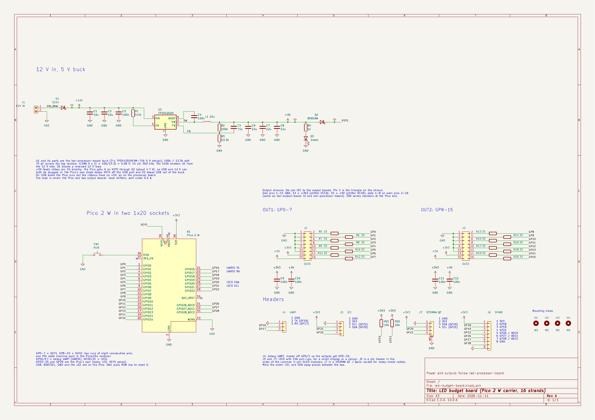

# led-budget-board

A "budget" LED processor board: a carrier for a Raspberry Pi Pico 2 W that drives 16 strands
through two of the standard 16-pin output shrouds. Little sibling of
[led-processor-board](https://github.com/eelstretching/led-processor-board).

## What it is

| | led-processor-board | led-budget-board |
|---|---|---|
| Brain | RP2350B, flash, PSRAM and RM2 radio on the board | A Pico 2 W in two 1x20 sockets |
| Outputs | 4 shrouds, 32 strands, GPIO0-31 | 2 shrouds, 16 strands: OUT1 = GP0-7, OUT2 = GP8-15 |
| RTC | DS3231 and coin cell | None: time comes from the show leader's PicoComm beacons |
| USB, BOOTSEL, LED, SWD | On the board | The Pico's own |
| Debug UART | UART1 on GPIO36/37 | UART0 on GP16 (TX) / GP17 (RX), header J4 |
| I2C | (v1.1) I2C0 on GPIO32/33 | I2C0 on GP20 (SDA) / GP21 (SCL), 10k pull-ups: pin header J5 and STEMMA QT / Qwiic socket J7 |
| Spare I/O | GPIO35-42 | GP18, GP19, GP22, GP26-28 on header J6 |
| 3.3 V | NCP1117 on the board | The Pico's 3V3 pin |

The same on both boards:

- Shroud pinout: data 1-8 on even pins 2-16, GND on odd pins 1-11, pin 13 = 3.3 V, pin 15 = 5 V.
  Pin 1 is the triangle on the shroud. 33R in series with each data line, 100 nF on each rail.
- Power: 12 V screw terminal, SS34 against a reversed lead, TPS54202H 5 V buck (same parts and
  values), then a B5819W into the Pico's VSYS so USB and 12 V can be plugged in together.
- RUN button and a 5 V power LED.

## Files

- `led-budget-board.kicad_sch`: the schematic (KiCad 10), one A3 sheet. PDF in `docs/schematic.pdf`.
- `led-budget-board.kicad_sym`: the Pico 2 W symbol (the stock Pico W symbol with AGND made passive and
  the through-hole footprint).
- `tools/build_schematic.py`: wrote the first version of the schematic. Edit the schematic in KiCad from
  now on; re-running the script overwrites it.

## Still to do

- PCB layout. Lessons from processor board v1 to carry over: shrouds face so the ribbons need no twist,
  the 12 V terminal sits fully on the board, every part is one JLCPCB can assemble (through-hole too).
- Pick LCSC parts for the through-hole parts (shrouds, 1x20 sockets, pin headers).
- A `led_budget_board.h` board header for the firmware (default UART on GP16/17).
